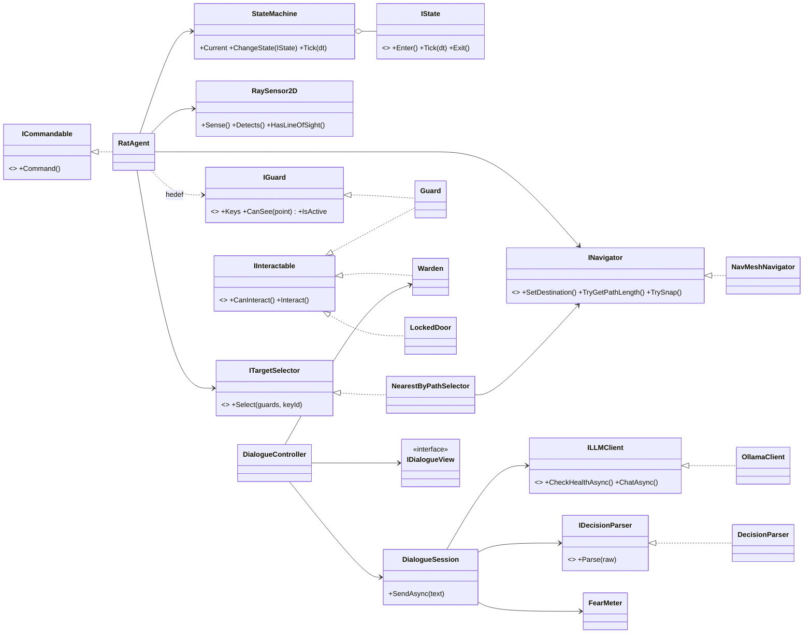
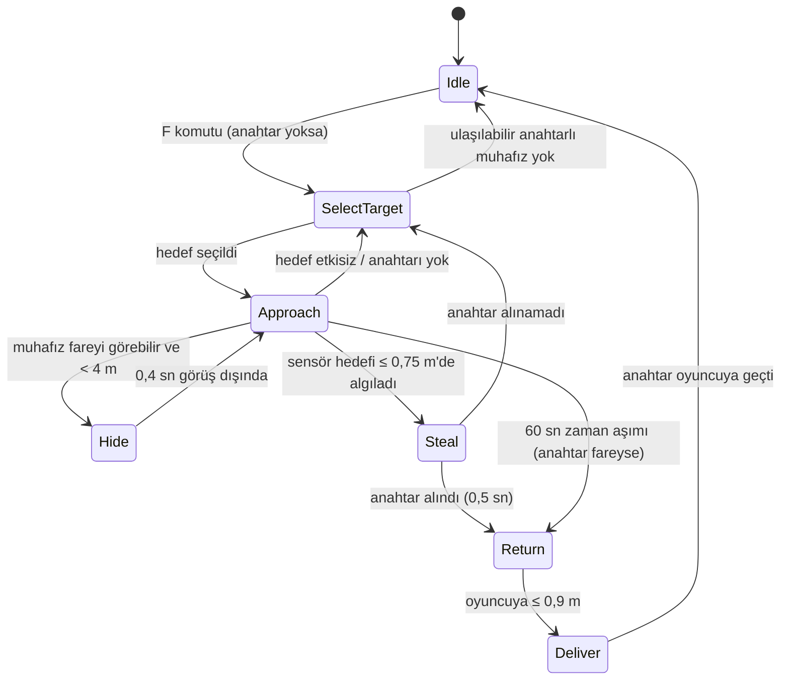
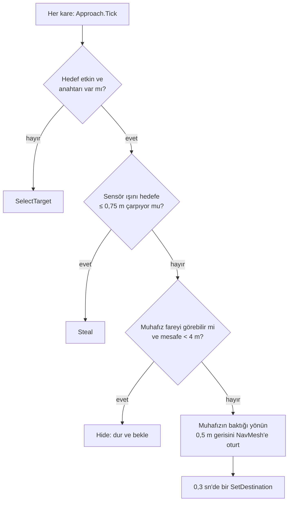
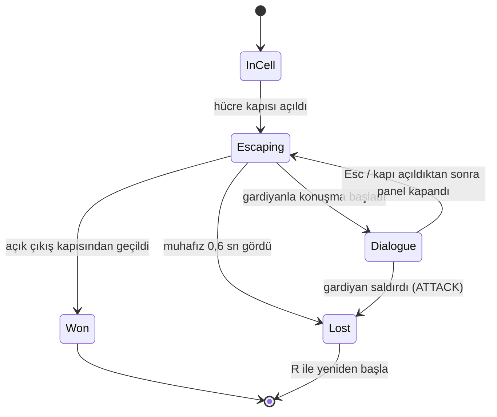

# Zindandan Kaçış

**Kocaeli Üniversitesi · Bilişim Sistemleri Mühendisliği · Yazılım Geliştirme Laboratuvarı-I · Proje 1**

| | |
|---|---|
| Ekip | Hüseyin Melih Güzel · Ömer Alp Dikmen |
| Tarih | Kasım 2026 |
| Motor | Unity 6000.6.6f1 (URP 2D), C# |
| Yapay zekâ | NavMesh (NavMeshPlus) otonom yoldaş · Ollama üzerinde yerel LLM (`gemma3:4b`) |

Kuşbakışı 2D bir zindandan kaçış oyunu. Oyuncu, hücresinden yalnızca küçük bir farenin geçebileceği bir delikten yoldaşı fareyi gönderir. Fare NavMesh ile yol bulup en yakın muhafızın anahtarını çalar ve geri getirir. Oyuncu hücreden çıkar, muhafızları sessizce etkisiz hâle getirir ve çıkış kapısındaki son gardiyanı, yerel bir dil modeliyle serbest metinle konuşarak, kapıyı açacak kadar korkutur.


## İçindekiler

1. [Giriş](#1-giriş)
2. [Kurulum ve Çalıştırma](#2-kurulum-ve-çalıştırma)
3. [Mimari](#3-mimari)
4. [Otonom AI Kahraman: Fare](#4-otonom-ai-kahraman-fare)
5. [Muhafızlar ve Oyun Akışı](#5-muhafızlar-ve-oyun-akışı)
6. [LLM Entegrasyonu: Gardiyan Bertan](#6-llm-entegrasyonu-gardiyan-bertan)
7. [Hata Yönetimi](#7-hata-yönetimi)
8. [Testler ve Sonuçlar](#8-testler-ve-sonuçlar)
9. [Sonuç ve Tartışma](#9-sonuç-ve-tartışma)

## 1. Giriş

### 1.1. Problem ve amaç

Projenin amacı, tek bir Unity oyununda birbirinden bağımsız iki yapay zekâ bileşenini bütünleştirmektir:

- **Otonom yoldaş:** Oyuncunun kendi başına aşamadığı fiziksel bir engeli, NavMesh yol bulma ve ışın (raycast) tabanlı algılama ile aşan bir karakter.
- **Yerel LLM destekli NPC:** Oyuncunun serbest metinle konuştuğu, yanıtlarını yerelde çalışan bir dil modeliyle üreten ve kararını **yapılandırılmış JSON** olarak bildiren bir karakter.

Her iki bileşen de sahte/hardcoded davranış içermez: farenin her adımı NavMesh'ten, gardiyanın her cümlesi Ollama'dan gelir. Oyun, sunucu kapalı olsa ya da model bozuk çıktı verse bile çökmez.

### 1.2. Oyun senaryosu


| Ödev isteri | Oyundaki karşılığı |
|---|---|
| Oyuncunun aşamadığı fiziksel engel | Hücre; duvardaki tünel yalnızca farenin NavMesh alanına açık |
| Komutla çalışan otonom companion | `F` tuşu → `RatAgent.Command()` |
| NavMesh yol bulma | NavMeshPlus 2D yüzeyleri, iki ajan tipi (Rat, Guard) |
| Sensör tabanlı gözlem (Raycast) | `RaySensor2D`: 16 ışınlık demet, engel/muhafız mesafe ve açısı |
| Açıkça tasarlanmış karar mantığı | Farenin 7 durumlu sonlu durum makinesi |
| Kilitli kapıyı koruyan, serbest metinle konuşulan NPC | Gardiyan Bertan |
| Yerel model (Ollama) | `gemma3:4b`, `http://localhost:11434` |
| Yapılandırılmış çıktı ve sınıfla ayrıştırma | JSON şeması → `DecisionParser` → `GuardDecision` |
| Bozuk çıktı, sunucu kapalı, zaman aşımı | Hata türleri, bir kez onarım, kullanıcıya mesaj; oyun durumu değişmez |
| Bloklamayan async, "Düşünüyor..." | `async/await` + `UnityWebRequest`, animasyonlu gösterge |

## 2. Kurulum ve Çalıştırma

### 2.1. Gereksinimler

- Unity **6000.6.6f1** (projeyi açınca paketler otomatik kurulur: NavMeshPlus, AI Navigation, Input System, URP, Newtonsoft JSON)
- [Ollama](https://ollama.com/) ve model:

```bash
ollama pull gemma3:4b
ollama serve        # masaüstü uygulaması açıksa zaten çalışıyordur
```

Ollama başka bir makinede çalışıyorsa `Assets/_Project/Settings/OllamaSettings.asset` içindeki `baseUrl` alanı `http://<ip>:11434` yapılır (projede düz HTTP'ye izin verildi).

### 2.2. Çalıştırma

- **Build:** `Builds/macOS/ZindandanKacis.app` (teslim arşivinde).
- **Editör:** `Assets/_Project/Scenes/Main.unity` açılıp Play'e basılır.
- Sahne tamamen koddan üretilir: `Dungeon Escape → Rebuild Scene` menüsü haritayı, oyuncuyu, NavMesh'i, muhafızları, diyalog arayüzünü ve HUD'u sırayla yeniden kurar.

### 2.3. Kontroller

| Tuş | Eylem |
|---|---|
| WASD / Oklar | Yürü |
| F | Fareye emir ver (anahtarı getir) |
| E | Etkileşim: kapı, muhafızı etkisiz hâle getirme, gardiyanla konuşma |
| Enter | Diyalogda mesaj gönder |
| Esc | Duraklat / konuşmayı bitir |
| R | Oyun bitince yeniden başla |

## 3. Mimari

### 3.1. Klasör ve derleme birimleri

```
YazLabUnity/Assets/_Project/
├── Scripts/                     DungeonEscape.Runtime (asmdef)
│   ├── Core/                    StateMachine, IState, GameEvents, GameFlow
│   ├── Level/                   LevelLayout (ASCII harita), SpawnMarker, ExitZone
│   ├── Characters/              CharacterAnimator, CharacterSpriteSet
│   ├── Player/                  PlayerController, IPlayerInput, CameraFollow
│   ├── Interaction/             IInteractable, Interactor, IKeyHolder, KeyRing, LockedDoor
│   ├── Navigation/              INavigator, NavMeshNavigator, NavMeshRuntimeBaker
│   ├── Companion/               RatAgent, RaySensor2D, ITargetSelector, States/
│   ├── Guards/                  IGuard, Guard, GuardVision, GuardSpawner, Warden, States/
│   ├── Dialogue/                ILLMClient, OllamaClient, DecisionParser, DialogueSession, ...
│   ├── UI/                      GameHud, ObjectiveText
│   └── Editor/                  DungeonEscape.Editor: sahne kurulum araçları
├── Tests/
│   ├── EditMode/                saf mantık testleri (52)
│   ├── PlayMode/                sahne içi testler (26)
│   └── Benchmarks/              uzun ölçümler: fare ×50, diyalog senaryoları
├── Tiles/level01.txt            ASCII harita (tek doğru kaynak)
└── Art/                         tileset, karakterler (Tools/generate_characters.py ile üretildi)
```

Çalışma zamanı kodu 64 dosya ve yaklaşık 3.700 satırdır. Ayrıca yaklaşık 1.100 satır editör aracı ve 1.570 satır test kodu vardır.

### 3.2. Sınıf diyagramı



### 3.3. OOP ve SOLID uygulaması

| İlke | Projedeki karşılığı |
|---|---|
| Tek sorumluluk | `RaySensor2D` yalnızca algılar, `NearestByPathSelector` yalnızca seçer, `DecisionParser` yalnızca ayrıştırır, `DialogueView` yalnızca gösterir |
| Açık/kapalı | Yeni bir fare veya muhafız davranışı, mevcut durumlara dokunmadan yeni bir `IState` sınıfıyla eklenir; hedef seçme stratejisi `ITargetSelector` ile değişir |
| Liskov | Testlerde `TestGuard`, `FakePlayerInput`, `ScriptedClient` gerçek sınıfların yerine geçer ve oyun aynı çalışır |
| Arayüz ayrımı | `IKeyHolder`, `IInteractable`, `IGuard`, `ICommandable` küçük ve amaca özel arayüzlerdir |
| Bağımlılığın tersine çevrilmesi | `DialogueSession` somut Ollama'yı değil `ILLMClient`'ı, fare somut NavMeshAgent'ı değil `INavigator`'ı bilir |
| Gevşek bağlılık | Bileşenler birbirini değil `GameEvents` olay yolunu dinler (kapı açıldı, anahtar teslim edildi, oyun bitti) |

## 4. Otonom AI Kahraman: Fare


### 4.1. Yol bulma: NavMesh

2D harita için [NavMeshPlus](https://github.com/h8man/NavMeshPlus) kullanıldı. NavMesh, sahne açılırken `NavMeshRuntimeBaker` tarafından çalışma anında pişirilir (harita küçük olduğundan birkaç milisaniye sürer).

| Ajan tipi | Yarıçap | Kullanabildiği alanlar |
|---|---|---|
| `Rat` | 0,15 | Walkable + **RatTunnel** |
| `Guard` | 0,30 | Yalnızca Walkable (tünel alan maskesinde kapalı) |

Hücrenin kuzey duvarındaki tünel, Tilemap'te ayrı bir katmandır. NavMesh'te `RatTunnel` alanı olarak işaretlenir ve oyuncu için katı bir collider'dır. Böylece:

- Fare hücreden salona **yalnızca tünelden** gider. Kapalı kapı hücreleri NavMesh'te yürünemez.
- Muhafızlar hücreye giremez (`PathPartial`).
- Oyuncu tünelden geçemez (bkz. `PlayerEscapeTests.RatTunnel_BlocksPlayer`).

Fare tünelin içindeyken duvar karoları farenin üstünde çizilir; fare oyuncunun gözünden kaybolur ve diğer uçtan çıkar.

### 4.2. Algılama: ışın sensörü

`RaySensor2D` her 0,1 saniyede farenin çevresine 16 eşit aralıklı ışın (`Physics2D.Raycast`, 3 m) gönderir. Her ışın, `Walls` ve `Guards` katmanlarına çarpma **mesafesini** ve **açısını** ölçer. Fare bu ölçümleri şunlar için kullanır:

- **Hedef menzilde mi?** Işınlardan biri hedef muhafıza 0,75 m içinde çarpıyorsa çalma başlar. Demetin arasında kalan hedefler için doğrudan görüş hattı ışını da atılır.
- **En yakın engel:** Hangi yönde ne kadar boşluk olduğu (gizmo ile kırmızı/yeşil çizilir).

Muhafızın fareyi görüp görmediği ise muhafızın kendi görüş konisiyle (`IGuard.CanSee`) hesaplanır. Koni de ışınlarla duvarlarda kırpılır.

### 4.3. Hedef seçimi

`NearestByPathSelector`, anahtarı olan ve etkin her muhafız için `NavMesh.CalculatePath` ile **yol uzunluğunu** hesaplar ve en kısasını seçer. Kuş uçuşu mesafe kullanılmaz: duvarın hemen arkasındaki muhafız yakın görünse de tünelden dolaşmak gerektiği için uzak olabilir (`TargetSelectorTests.PicksShortestPath_NotStraightLineDistance`).

### 4.4. Karar mantığı: sonlu durum makinesi



Her durum ayrı bir `IState` sınıfıdır (`Companion/States/`). Geçişler yalnızca `StateMachine.ChangeState` ile yapılır. Bir durumun `Enter`'ı içinden istenen geçiş sıraya alınır, böylece olaylar doğru sırayla yayınlanır.

Yaklaşma adımının ayrıntılı akışı:



### 4.5. Görev raporu

Her görev bir `RatMissionReport` üretir: başarı, süre, hedefe yol uzunluğu, saklanma sayısı ve başarısızlık nedeni. Test ve ölçümler bu raporu kullanır (bkz. [8.2](#82-fare-ölçümü-50-farklı-başlangıç)).

## 5. Muhafızlar ve Oyun Akışı


- **Yerleşim:** `GuardSpawner`, 6 aday noktadan seed'li rastgelelikle 3 tanesini seçer ve noktanın 1,2 m çevresinde NavMesh üzerinde bir yere, birbirine en az 2,5 m uzaklıkta yerleştirir. Aynı seed her zaman aynı yerleşimi verir (`GuardTests.SameSeed_GivesSameLayout`). Oyunda seed her seferinde değişir.
- **Davranış:** Her muhafızın kendi durum makinesi vardır: `LookAround` (2-3 kez rastgele yöne bakar) ⇄ `Patrol` (evinin 3 m çevresinde ulaşılabilir rastgele noktaya yürür) → `Neutralized`.
- **Görüş:** 4 m menzil, 90° açı, duvar engeli. Koni oyunda yarı saydam görünür; oyuncuyu görünce kırmızıya döner.
- **Yakalanma:** Hücre kapısı açıldıktan sonra bir muhafız oyuncuyu 0,6 sn kesintisiz görürse oyun kaybedilir.
- **Etkisiz hâle getirme:** Oyuncu muhafızın arkasından (bakış yönüyle ≥ 110°, ≤ 1,1 m) yaklaşıp `E`'ye basar. Önden yaklaşırsa ekranda "Arkasından yaklaş!" yazar.
- **Gardiyan:** Çıkış kapısının önünde durur, `IGuard` değildir (fare onu hedef almaz). Tüm muhafızlar etkisiz kalınca konuşmaya açılır.

Oyunun üst düzey akışı (`GameFlow`):


